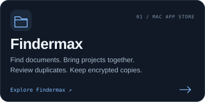
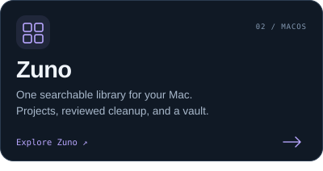
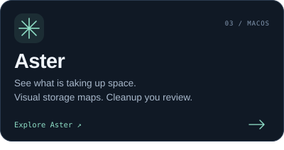
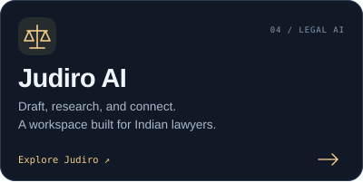
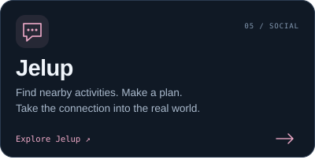
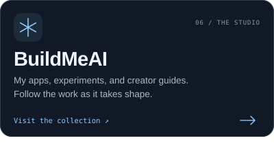
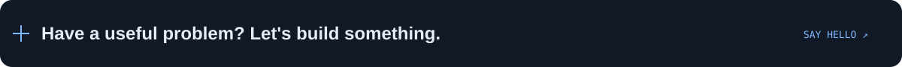

<p align="center">
  <picture>
    <source media="(max-width: 640px)" srcset="./assets/hero-mobile.svg">
    
  </picture>
</p>

<p align="center">
  <a href="https://shivamrohilla.xyz/"><strong>PORTFOLIO&nbsp;↗</strong></a>
  &nbsp;&nbsp;
  <a href="https://buildmeai.co/"><strong>APPS&nbsp;↗</strong></a>
  &nbsp;&nbsp;
  <a href="https://dev.to/shivamrohilla"><strong>WRITING&nbsp;↗</strong></a>
  &nbsp;&nbsp;
  <a href="mailto:shivamrohillaa@gmail.com"><strong>EMAIL&nbsp;↗</strong></a>
</p>

<br>

I’m **Shivam**, a software engineer and independent app builder. My foundation is **5+ years of Python, backend engineering, and production systems**. These days, that work also takes the shape of native Mac apps, AI products, and tools for everyday problems.

**[BuildMeAI](https://buildmeai.co/)** is where my products live. I work across the API, the interface, and the release—and write about what I learn along the way.

<br>

## 01 / Selected builds

<p align="center">
  <a href="https://buildmeai.co/findermax"></a>
  <a href="https://buildmeai.co/zuno"></a>
</p>
<p align="center">
  <a href="https://buildmeai.co/aster"></a>
  <a href="https://judiro.com/"></a>
</p>
<p align="center">
  <a href="https://jelup.app/"></a>
  <a href="https://buildmeai.co/"></a>
</p>

<br>

## 02 / Behind the builds

```text
BACKEND & APIs      Python · Django · DRF · FastAPI
DATA & JOBS         PostgreSQL · Redis · Celery
NATIVE APPS         Swift · SwiftUI · AppKit
CLOUD & DELIVERY    AWS · Docker · Jenkins · CI/CD
AI & AUTOMATION     LLM integrations · LangChain · Webhooks
```

<details>
<summary><strong>More tools & engineering background</strong></summary>

<br>

- **Web & mobile:** JavaScript, HTML, CSS, Tailwind CSS, and Flutter.
- **Data:** PostgreSQL and MySQL, with Redis for caching and Celery for background work.
- **Experience:** Previously led backend engineering at NetCom Learning and built Python applications at KiwiTech.
- **Interests:** API architecture, database performance, native interfaces, and getting useful software into people’s hands.

</details>

<br>

## 03 / Open-source shelf

| Project | Inside the repository |
| :--- | :--- |
| **[Aster ↗](https://github.com/ShivamRohilllaa/aster)** | Swift + SwiftUI storage explorer, interactive disk maps, and reviewed cleanup. |
| **[E-learning Django ↗](https://github.com/ShivamRohilllaa/E-learning-Django-)** | Course purchases, payments, certificates, and an admin dashboard. |
| **[Django + Redis ↗](https://github.com/ShivamRohilllaa/django-redis)** | A practical example of adding Redis to a Django application. |
| **[Django Import / Export ↗](https://github.com/ShivamRohilllaa/django-import-export)** | Examples of importing and exporting application data. |

<br>

## 04 / Build. Share. Repeat.

I write about **Python, Django, and building apps**—from implementation notes to what happens after a release.

**[Read on DEV ↗](https://dev.to/shivamrohilla)** &nbsp; · &nbsp; **[Explore BuildMeAI ↗](https://buildmeai.co/)** &nbsp; · &nbsp; **[Follow the studio ↗](https://www.instagram.com/buildmeai/)**

<br>

<a href="mailto:shivamrohillaa@gmail.com">
  <picture>
    <source media="(max-width: 640px)" srcset="./assets/connect-mobile.svg">
    
  </picture>
</a>

<p align="center"><sub>Made in New Delhi. Built with curiosity.</sub></p>
